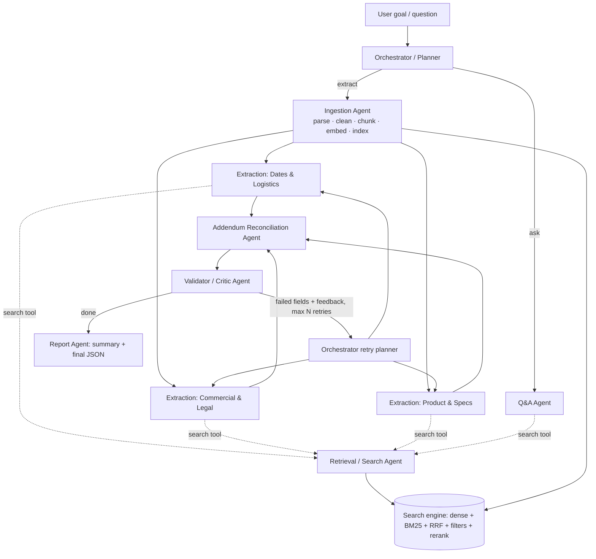

# RFP Intelligence Platform – RAG Search Engine + LangGraph Multi-Agent System

Understands bid / RFP folders (HTML + PDF + addenda), makes them **searchable** (hybrid RAG search engine),
**answerable** (cited Q&A) and **extractable** (20-field JSON, every value cited, addenda applied).
Stack: Python 3.10+, **LangGraph**, **Gemini (Google AI Studio)**, PyMuPDF, BeautifulSoup, BM25, Streamlit, FastAPI.

## 1. Setup

```bash
python -m venv .venv && source .venv/bin/activate      # Windows: .venv\Scripts\activate
pip install -r requirements.txt
cp .env.example .env                                   # Windows: copy .env.example .env
#   then put your Google AI Studio key in .env  ->  GOOGLE_API_KEY=...
```

Put each bid in its own folder under `data/bids/` (the folder name is the `bid_id`):

```
data/bids/Bid1/  (BidNet page .html, RFP .pdf, Addendum 1 .pdf, Addendum 2 .pdf)
data/bids/Bid2/  (BidNet page .html, RFP .pdf, Specs .pdf, Contract Affidavit .pdf, Mercury Affidavit .pdf)
```

## 2. Run

| Goal | Command |
|---|---|
| **Extraction (one command)** | `python main.py --bid ./data/bids/Bid1` → `output/Bid1.json`, `Bid1_report.md`, `Bid1_trace.md` |
| Web UI (search, chat, extract, eval) | `streamlit run app.py`  (or `python main.py ui`) |
| Index a bid (incremental) | `python main.py index ./data/bids/Bid2` |
| CLI search | `python main.py search "bid bond" --bid_id Bid1 --doc_type rfp --top_k 5 --mode hybrid_rerank` |
| Ask a question | `python main.py ask "What is the submission deadline for Bid1 after all addendums?"` |
| Sample Q&A log (14 questions) | `python main.py qa-log` → `output/sample_qa_log.md` |
| Retrieval evaluation | `python main.py eval` → `eval/results.md` |
| REST API | `python main.py serve` → `POST /index`, `GET /search?q=...&bid_id=...&top_k=5`, `POST /ask`, `POST /extract`, `GET /bids` |
| Tests | `pytest` (parsing + search, offline – uses a hash embedder, no API key needed) |
| Docker | `docker compose up` (UI :8501, API :8000) |

A new, unseen bid folder needs **no code change**: drop it in `data/bids/`, then extract or use the UI's “Add a new bid”.

> **Free-tier note:** extraction makes roughly 30–40 Gemini calls per bid. `LLM_RPM` (default 12) throttles all agents
> centrally and 429s are retried with back-off; expect a few minutes per bid. Raise `LLM_RPM` with a paid key.
> Faster/cheaper options: `RERANK_IN_EXTRACTION=false`, `GEMINI_THINKING_BUDGET=0`.

## 3. Architecture



Shared state (`agents/state.py`, a LangGraph `TypedDict` with parallel-safe reducers) holds the plan, evidence, draft fields,
addendum change log, validation report, retry counters, errors and the final output. All agent-to-agent messages are Pydantic models
(`agents/schemas.py`). Agents never receive whole documents – only passages returned by the search engine
(addenda, being short, are read in full through the engine's `get_chunks` call during reconciliation).

| Agent (file) | Responsibility |
|---|---|
| Orchestrator (`orchestrator.py`) | picks mode, builds plan, fans out field groups in parallel (LangGraph `Send`), runs the retry loop, decides when done |
| Ingestion (`orchestrator.py` → `ingestion/`, `search/engine.py`) | parse HTML/PDF + tables, clean, metadata, chunk, embed, incremental index |
| Retrieval (`retrieval.py`) | query expansion/rewrite, metadata filters, hybrid search + rerank, returns cited evidence |
| Extraction ×3 (`extraction.py`) | fill fields from numbered evidence only; verbatim quotes are verified against the passage |
| Addendum Reconciliation (`reconcile.py`) | processes addenda in numeric order, applies latest valid change per field (only when its quote is verifiable), writes change log |
| Validator/Critic (`validator.py`) | citation + quote verification, format checks (date, contact), LLM support check; failed fields go back with feedback |
| Q&A / Report (`qa.py`, `report.py`) | cited answers ("Not found in documents." when unsupported); final JSON + generated summary |

Guardrails: unsupported values become `null` / "Not found in documents"; a non-null value without a verified citation fails validation;
Q&A answers without citations are rejected. Errors (LLM timeout, bad JSON, empty retrieval, unreadable file) are caught per node/step and
never crash the pipeline; failed LLM JSON is re-prompted twice.

## 4. Design decisions

* **Agent framework – LangGraph.** Explicit state graph, native parallel fan-out (`Send`) for the three extraction specialists, conditional
  edges for the validator→retry loop, reducers for safe parallel writes. Retries are capped (`MAX_FIELD_RETRIES`, default 2).
* **Parsing.** PyMuPDF text blocks in reading order + `find_tables()` → Markdown tables (overlapping text blocks dropped to avoid
  duplicates); BeautifulSoup for HTML with tables → Markdown. Cleaning: repeated header/footer/page-number removal, de-hyphenation, broken-line
  joining, whitespace normalisation. Empty/scanned pages are logged (`data/logs/ingestion.jsonl`) and OCR is attempted if Tesseract is installed.
  Metadata per chunk: `bid_id, file_name, doc_type (bid_page|rfp|addendum|specs|affidavit), addendum_number, page_number, doc_date, section`.
* **Chunking (justification).** Heading-aware, table-aware, page-bounded (exact page citations). Target ≤1200 chars (~250–300 tokens): large enough to keep a
  clause with its conditions (e.g. a bond percentage with its exception), small enough that one passage answers one question and re-ranking stays precise.
  Overlap 150 chars (sentence-based splits for long paragraphs, last short paragraph carried over on size-triggered splits). Tables are separate chunks,
  split by rows with the header repeated. Each embedded chunk is prefixed with `[bid | doc type | file | page] section` so vectors know their context.
* **Embeddings.** `gemini-embedding-001` (768-dim, task types RETRIEVAL_DOCUMENT / RETRIEVAL_QUERY) via the same API key. Swap with `EMBED_MODEL`.
* **Vector store.** Persistent on-disk index (`data/index/`: chunks.jsonl, vectors.npy, manifest.json) with exact cosine search – equivalent to FAISS `IndexFlatIP`
  and ideal for corpora of thousands of chunks; metadata filtering is a boolean mask. For large scale replace `search/store.py` with FAISS/Qdrant.
  **Incremental indexing:** each bid folder has a content fingerprint; unchanged bids are skipped, changed bids replace only their own chunks.
* **Retrieval.** Dense + BM25 (tokeniser keeps IDs like `JA-207652` / `210-BMKX` and their parts) fused with **Reciprocal Rank Fusion** (k=60) across
  all query variants → metadata filters (bid, doc type, addendum number, file) → **listwise Gemini re-ranker** (optional cross-encoder via `RERANKER_BACKEND=cross_encoder`).
  Query understanding: rule-based synonym expansion ("deadline" → due date, closing date, …), LLM query planning for questions (sub-queries per bid / doc type,
  explicit "Addendum N" is read directly), LLM rewrite on retries. If embeddings are unavailable the engine degrades to BM25.
* **Addendum logic.** Retrieval always adds the best addendum hits for each field; extraction prefers the highest addendum; reconciliation re-checks every field against each
  addendum in order and records `{addendum_number, field, old_value, new_value, page, quote, applied}`.
* **Observability.** Every agent step → one JSON line in `data/traces/<run_id>.jsonl` (input, output, tool calls, LLM calls, tokens, latency) and a readable
  `output/<bid>_trace.md` (**this is the example agent trace**).

## 5. Retrieval evaluation

`eval/eval_set.json` has 17 questions over both bids. Run `python main.py eval` to fill the table below (compares vector-only, BM25-only, hybrid, hybrid + re-ranker):

| Configuration | Recall@1 | Recall@3 | Recall@5 | MRR |
|---|---|---|---|---|
| vector-only | _run eval_ | | | |
| bm25-only | | | | |
| hybrid (RRF) | | | | |
| hybrid + LLM re-ranker | | | | |

**Important:** the eval set was written from the assignment text *without access to your PDFs*. A chunk counts as relevant if it matches `file_contains`,
`doc_type`, any of `text_any` and all of `text_all`. Before reporting numbers, open your documents and tighten `text_any/text_all` to the exact phrases that
answer each question – otherwise the metrics will look better than they are.

## 6. Deliverables checklist

| Deliverable | Where |
|---|---|
| Source code | this repo |
| JSON per bid | `output/Bid1.json`, `output/Bid2.json` (after running extraction) |
| Retrieval eval report | `eval/eval_set.json`, `eval/results.md` |
| Sample Q&A log (≥10) | `python main.py qa-log` → `output/sample_qa_log.md` |
| Agent trace | `output/<bid>_trace.md` |
| Architecture diagram | section 3 |
| Demo | `streamlit run app.py` |

## 7. Assumptions & known limitations

* Bid id = folder name. One folder = one bid.
* Field values are strings (multiple values joined with `; `). `Due Date` is normalised to `YYYY-MM-DD HH:MM TZ` when stated.
* Scanned PDFs need Tesseract for OCR; otherwise they are logged and skipped. Image-only tables are not parsed.
* PDF tables without ruling lines may be extracted as plain text rather than Markdown tables.
* The LLM critic can be over- or under-strict; failed fields that exhaust retries are kept but marked `NEEDS REVIEW` with low confidence (or nulled when uncited).
* Default model is `gemini-2.5-flash` – set `GEMINI_MODEL` to any model your key supports.
* Exact (flat) vector search; fine for the target scale, not for millions of chunks.

## 8. Project layout

```
main.py  app.py  config.py  llm.py  observability.py  utils.py
ingestion/  parser.py chunker.py pipeline.py models.py
search/     engine.py store.py embeddings.py rerankers.py query.py
agents/     graph.py state.py schemas.py fields.py orchestrator.py retrieval.py extraction.py
            reconcile.py validator.py report.py qa.py runner.py runtime.py
api/server.py   eval/run_eval.py eval_set.json sample_questions.txt   tests/
```
